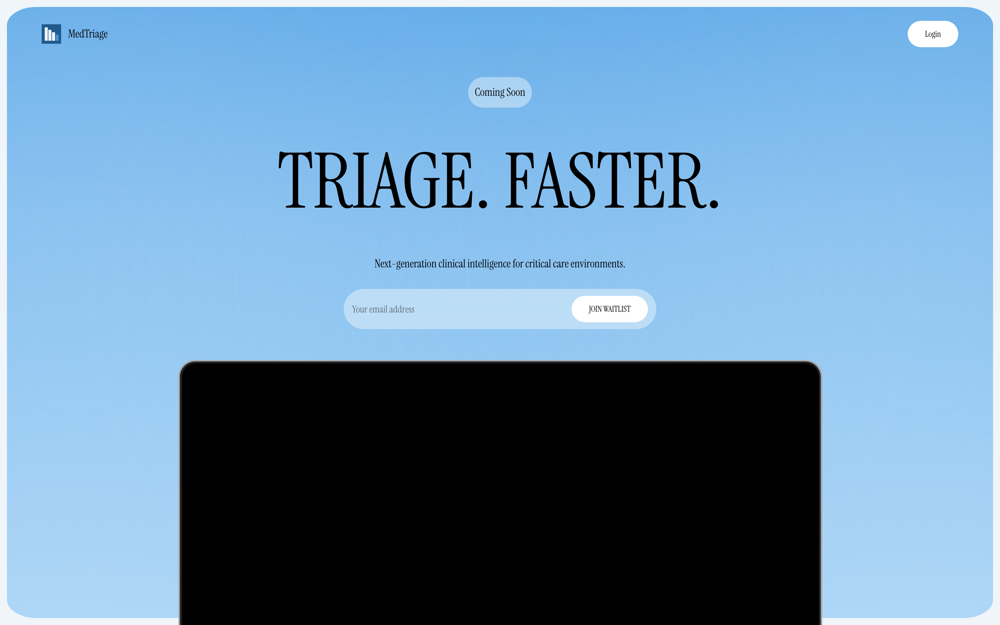
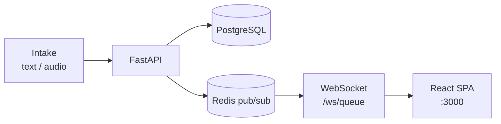
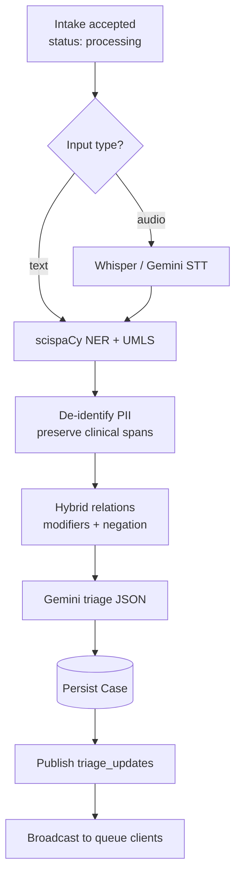
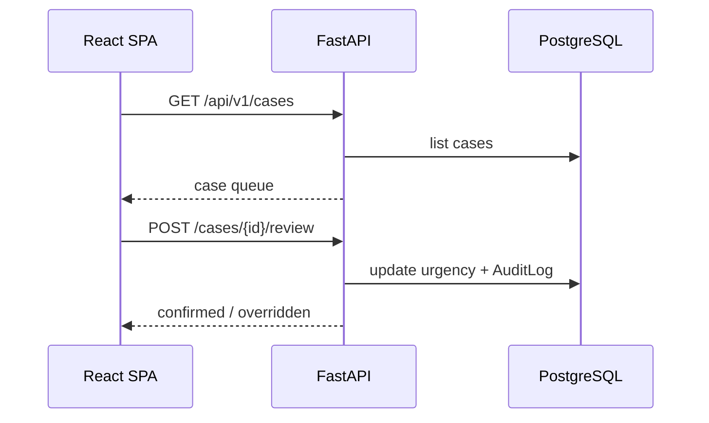
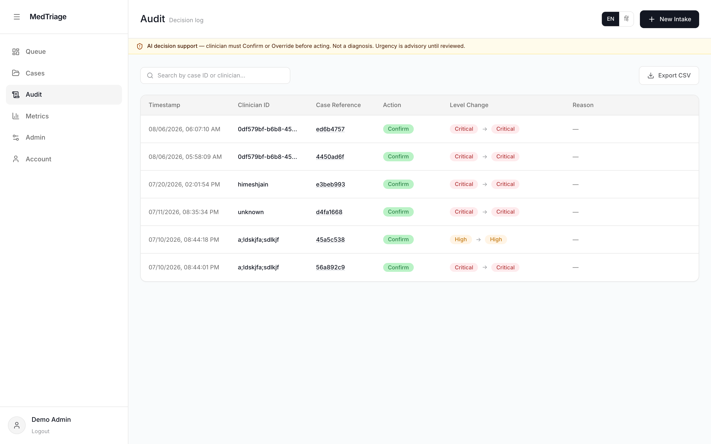
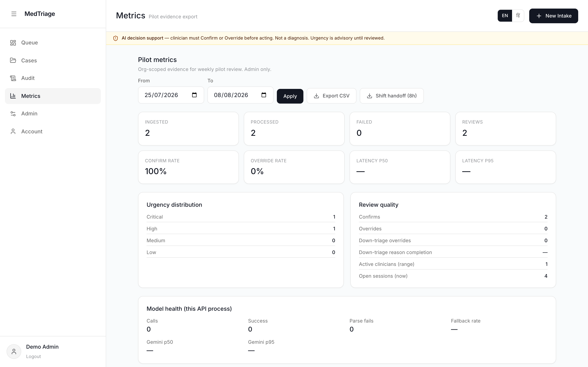
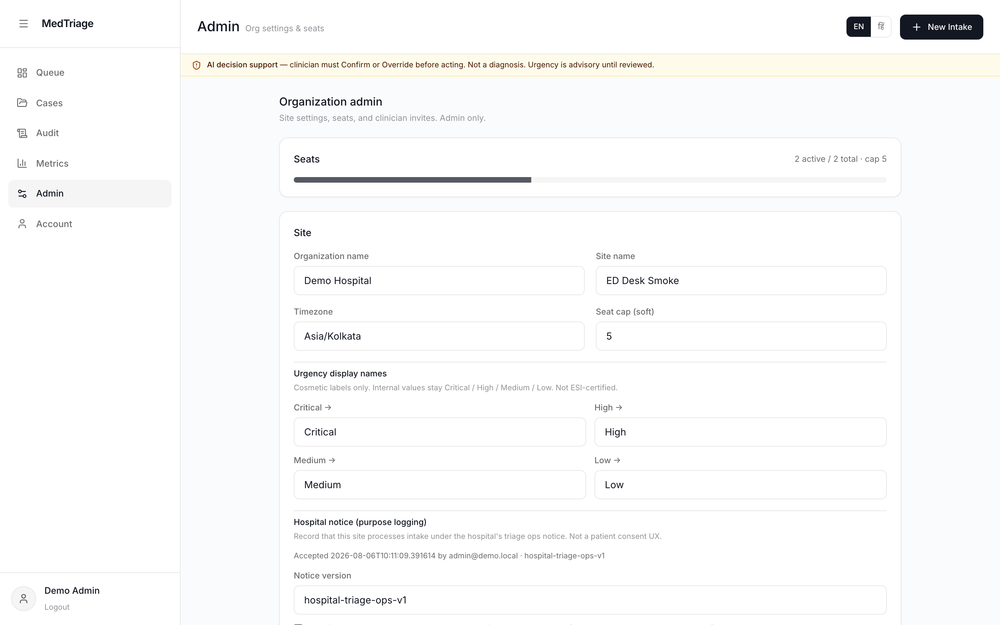

# MedTriage AI

**AI-assisted clinical triage decision support.** Turns unstructured intake — free-text notes or voice — into a structured, prioritized case summary. Clinicians confirm or override before action.

Built for acute-care and ED walk-in workflows. Supports clinical judgment. Does not diagnose, prescribe, or replace triage staff.

<br>

<p align="center">
  
  <br>
  <em>Product landing — intake → AI triage → live queue → clinician review → audit.</em>
</p>

<p align="center">
  
  <br>
  <em>Live triage queue with urgency filters, confidence, and one-click confirm.</em>
</p>

## Overview

MedTriage ingests free-text clinical notes or voice recordings, runs a multi-stage NLP pipeline (clinical NER, de-identification, relationship extraction), and produces a structured triage assessment via Gemini. Results fan out in real time over WebSocket. Every AI suggestion stays advisory until a clinician confirms or overrides — with a full audit trail.

## Features

- **Multi-modal intake** — text notes or voice audio (Whisper / Gemini STT)
- **Clinical NER** — scispaCy + UMLS entity linking on raw text
- **De-identification** — PHI scrubbing that preserves clinical spans
- **Hybrid relationship extraction** — modifiers, negation windows, keyword/context scanning
- **Structured triage** — chief complaint, symptoms, risk flags, urgency, confidence, evidence
- **Human oversight** — confirm or override urgency; critical cases prompt extra confirmation
- **Live queue** — Redis pub/sub → WebSocket fanout to connected clinicians
- **Cases index** — full case list with deep-link detail drawer
- **Audit log** — every confirm/override recorded
- **Pilot metrics** — handoff and override metrics for site evaluation (admin)
- **Org admin** — seats, invites, urgency label customization
- **Session auth** — httpOnly cookie sessions, invite-only register (bootstrap when empty)

## Architecture

### System flow



### AI triage pipeline



### Clinician review



## Screenshots

<p align="center">
  
  
  <br>
  <em>Text intake (left) and audio intake (right).</em>
</p>

<p align="center">
  
  <br>
  <em>Case detail drawer — triage summary, entities, confirm / override.</em>
</p>

<p align="center">
  
  <br>
  <em>Audit log of clinician confirmations and overrides.</em>
</p>

<p align="center">
  
  
  <br>
  <em>Pilot metrics (left) and org admin (right).</em>
</p>

## Tech Stack

| Layer | Technology |
|-------|-----------|
| Backend | FastAPI, SQLModel, SQLAlchemy async |
| Database | PostgreSQL (asyncpg) |
| Cache/messaging | Redis pub/sub |
| Auth | Session cookies (httpOnly), org tenancy, role-based admin |
| NLP | spaCy, scispaCy (BC5CDR + UMLS linker), ClinicalBERT (model path), Whisper |
| AI | Google Gemini (`google-genai` SDK) |
| Frontend | React 19 + TypeScript, Vite, Tailwind 4, Motion, Lucide |
| Routing | React Router 7 |
| Real-time | WebSocket (FastAPI native) |

## Getting Started

### Prerequisites

- Python 3.11+
- Node.js 20+
- PostgreSQL (running)
- Redis (running)
- Google Gemini API key

### Backend

```bash
# Clone and configure
cp .env.example .env
# Edit .env: GOOGLE_API_KEY, DATABASE_URL, REDIS_URL
# Optional demo admin: DEMO_ADMIN_EMAIL / DEMO_ADMIN_PASSWORD (defaults in .env.example)

# Create virtual environment
python3.11 -m venv .venv
source .venv/bin/activate

# Install core dependencies
pip install fastapi uvicorn sqlmodel sqlalchemy asyncpg redis pydantic-settings \
            google-genai spacy scispacy transformers torch openai-whisper \
            python-multipart

# Download spaCy models
python -m spacy download en_core_web_sm

# Place model weights under models/ per .env.example:
#   Whisper (models/whisper/), scispaCy BC5CDR (models/scispacy/),
#   ClinicalBERT (models/relations/)

# Run (default local port matches frontend proxy)
uvicorn app.main:app --reload --host 127.0.0.1 --port 8001
```

Or use `scripts/start-local.command` to bring up Postgres + API + Vite together (API on `:8000` — set `MEDTRIAGE_PROXY_TARGET` in `frontend/.env` to match).

### Frontend

```bash
cd frontend
cp .env.example .env   # MEDTRIAGE_PROXY_TARGET=http://127.0.0.1:8001
npm install
npm run dev    # UI at http://localhost:3000 — /api and /ws proxy to the API
```

Leave `VITE_API_URL` unset so the browser stays same-origin (session cookie is not dropped cross-site).

Demo login (seeded on first startup when the org is empty): `admin@demo.local` / `demo-change-me` (override via `.env`).

## API

| Method | Path | Description |
|--------|------|-------------|
| `POST` | `/api/v1/auth/login` | Session login |
| `POST` | `/api/v1/auth/logout` | End session |
| `GET` | `/api/v1/me` | Current user |
| `POST` | `/api/v1/auth/bootstrap` | First-org registration when empty |
| `POST` | `/api/v1/auth/invite` | Admin invite |
| `POST` | `/api/v1/intake` | Submit text or audio case → `status: processing` |
| `GET` | `/api/v1/cases` | List cases (newest first) |
| `GET` | `/api/v1/cases/{id}` | Case detail |
| `POST` | `/api/v1/cases/{id}/review` | Clinician confirm/override |
| `GET` | `/api/v1/audit` | Audit log |
| `GET` | `/api/v1/metrics` | Pilot metrics (admin) |
| `GET` | `/api/v1/org` | Org settings (admin) |
| `WS` | `/ws/queue` | Real-time triage updates |
| `GET` | `/` | Health check |

## Project Structure

```
.
├── app/
│   ├── main.py                 # FastAPI entry, WebSocket, startup
│   ├── api/v1/
│   │   ├── intake.py           # Text/audio intake + pipeline orchestration
│   │   ├── cases.py            # Cases, review, audit
│   │   ├── auth.py             # Login, bootstrap, invite, password
│   │   ├── metrics.py          # Pilot metrics export
│   │   └── admin.py            # Org + seats
│   ├── core/                   # Config, auth, security
│   ├── db/session.py           # Async engine + demo seed
│   ├── models/                 # Case, AuditLog, User, Org (SQLModel)
│   └── services/
│       ├── nlp.py              # scispaCy NER, hybrid relations
│       ├── deid.py             # PII masking
│       ├── intelligence.py     # Gemini triage (mock fallback)
│       └── queue.py            # Redis pub/sub broadcast
├── frontend/                   # React SPA (port 3000)
├── models/                     # Whisper, scispaCy, ClinicalBERT
├── screenshots/                # UI previews for this README
├── docs/                       # Ops + clinical notes
├── .env.example
├── LICENSE
└── README.md
```

## Safety Disclaimer

**MedTriage AI is a clinical decision support tool — not a medical device.** It is designed to augment, not replace, the judgment of qualified healthcare professionals. All AI-generated triage assessments must be reviewed by a licensed clinician before any clinical action is taken.

## License

[PolyForm Noncommercial License 1.0.0](LICENSE) — public source for education, research, personal, and nonprofit use. **Commercial use requires separate permission** from the copyright holder (Himesh Jain).

This is *source-available*, not OSI open source.
