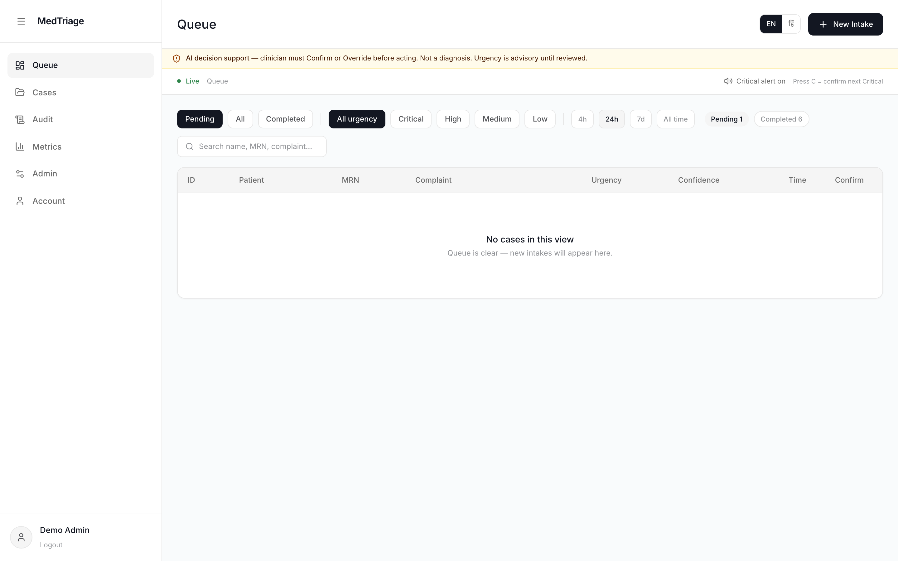
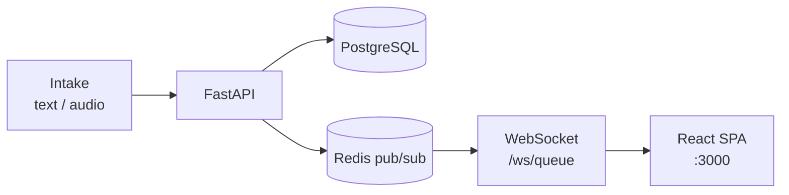
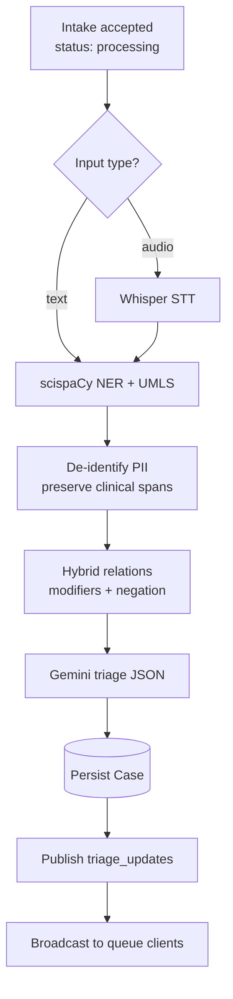
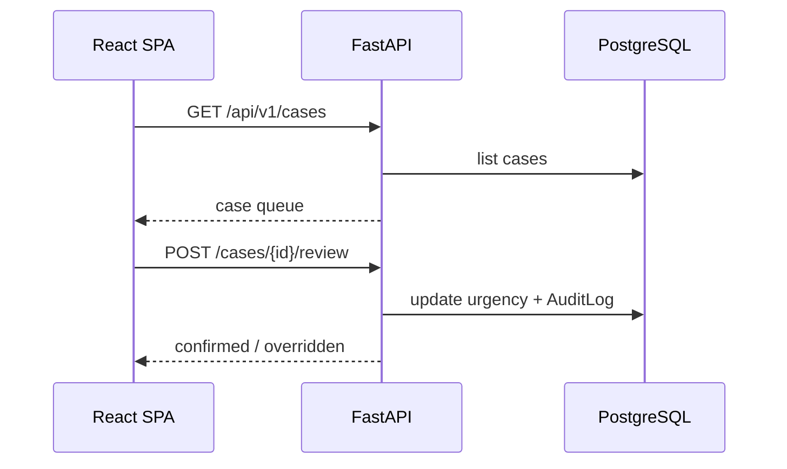
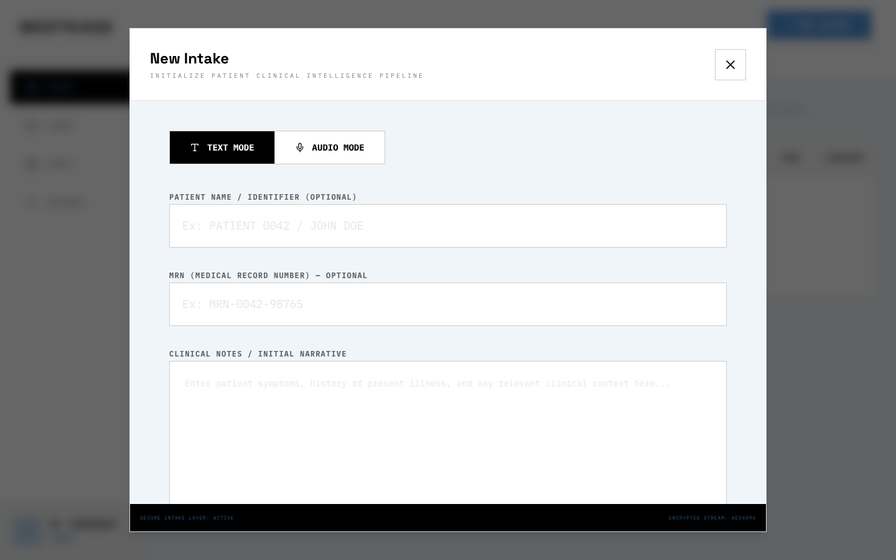
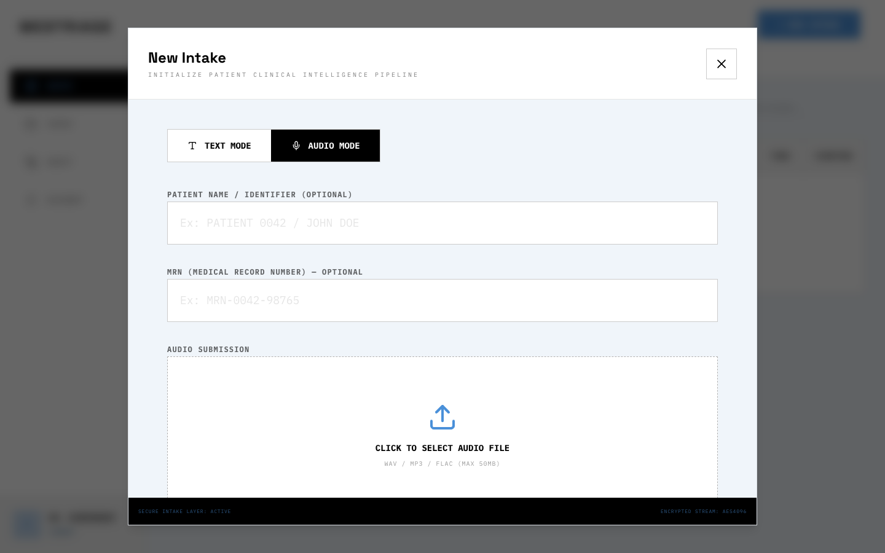
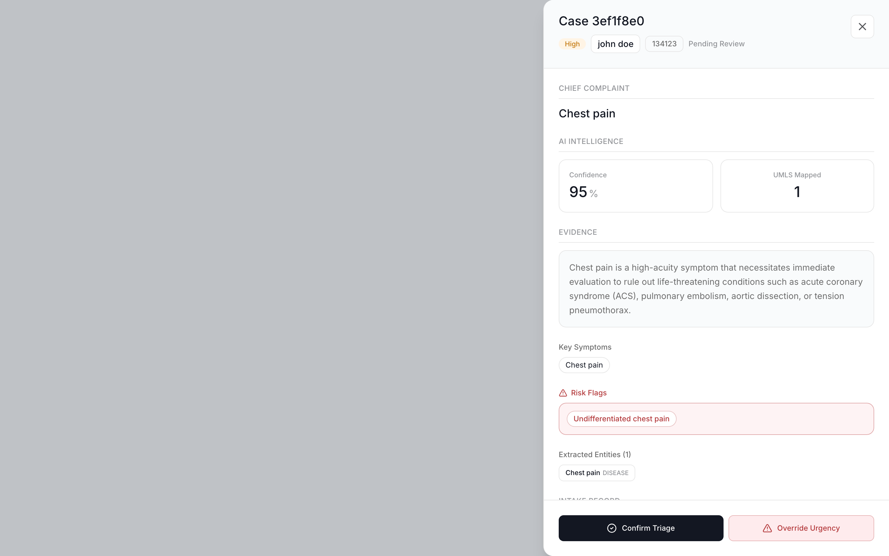

# MedTriage AI

**AI-powered clinical triage and decision support.** Converts unstructured intake (text notes, voice audio) into structured summaries with urgency prioritization for ER staff, nurses, and physicians.

<br>

<p align="center">
  
  <br>
  <em>Real-time triage queue with urgency badges and live WebSocket updates.</em>
</p>

## Overview

MedTriage ingests free-text clinical notes or voice recordings, runs them through a multi-stage NLP pipeline (clinical NER, de-identification, relationship extraction), and produces a structured triage assessment via Gemini. Results are broadcast in real time to connected clinicians over WebSocket.

This augments clinical judgment — it does not replace it. Every AI triage decision is reviewable and auditable.

## Features

- **Multi-modal intake** — text notes or voice audio (Whisper transcription)
- **Clinical NER** — scispaCy + UMLS entity linking on raw text
- **De-identification** — regex and spaCy NER with clinical-entity protection
- **Hybrid relationship extraction** — contextual modifiers, negation windows, and keyword/context scanning; ClinicalBERT model path present
- **Structured triage** — Gemini produces chief complaint, symptoms, risk flags, urgency level, confidence score, and evidence
- **Review & override** — clinicians confirm or adjust urgency with audit trail
- **Real-time queue** — Redis pub/sub fans out new cases to all WebSocket-connected clients
- **Full audit log** — every override and confirmation recorded

## Architecture

### System flow



### AI triage pipeline



### Clinician review



## Screenshots

<p align="center">
  
  
  <br>
  <em>Text intake (left) and audio intake (right) modals.</em>
</p>

<p align="center">
  
  <br>
  <em>Case detail with triage summary, entities, and review/override controls.</em>
</p>

<p align="center">
  
  <br>
  <em>Audit log showing clinician review history.</em>
</p>

## Tech Stack

| Layer | Technology |
|-------|-----------|
| Backend | FastAPI, SQLModel, SQLAlchemy async |
| Database | PostgreSQL (asyncpg) |
| Cache/messaging | Redis pub/sub |
| NLP | spaCy, scispaCy (BC5CDR + UMLS linker), ClinicalBERT (model path), Whisper |
| AI | Google Gemini (`google-genai` SDK) |
| Frontend | React 19 + TypeScript, Vite, Tailwind 4, Motion, Lucide |
| Routing | React Router 7 |
| Real-time | WebSocket (FastAPI native) |

## Getting Started

### Prerequisites

- Python 3.11+
- Node.js 20+
- PostgreSQL (running)
- Redis (running)
- Google Gemini API key

### Backend

```bash
# Clone and configure
cp .env.example .env
# Edit .env: add GOOGLE_API_KEY, DATABASE_URL, REDIS_URL

# Create virtual environment
python3.11 -m venv .venv
source .venv/bin/activate

# Install core dependencies
pip install fastapi uvicorn sqlmodel sqlalchemy asyncpg redis pydantic-settings \
            google-genai spacy scispacy transformers torch openai-whisper \
            python-multipart

# Download spaCy models
python -m spacy download en_core_web_sm

# Place model weights under models/ per .env.example:
#   Whisper (models/whisper/), scispaCy BC5CDR (models/scispacy/),
#   ClinicalBERT (models/relations/)

# Run
uvicorn app.main:app --reload    # API at http://localhost:8000
```

### Frontend

```bash
cd frontend
npm install
npm run dev    # UI at http://localhost:3000
```

## API

| Method | Path | Description |
|--------|------|-------------|
| `POST` | `/api/v1/intake` | Submit text or audio case (multipart) → returns case with `status: processing` |
| `GET` | `/api/v1/cases` | List all cases (newest first) |
| `GET` | `/api/v1/cases/{id}` | Single case detail |
| `POST` | `/api/v1/cases/{id}/review` | Clinician confirm/override urgency |
| `GET` | `/api/v1/audit` | Audit log entries |
| `WS` | `/ws/queue` | Real-time triage updates (Redis `triage_updates` fanout) |
| `GET` | `/` | Health check |

## Project Structure

```
.
├── app/
│   ├── main.py                 # FastAPI entry, WebSocket, startup
│   ├── api/v1/
│   │   ├── intake.py           # Text/audio intake + pipeline orchestration
│   │   └── cases.py            # CRUD + review + audit endpoints
│   ├── core/config.py          # Settings from .env
│   ├── db/session.py           # Async engine + session
│   ├── models/case.py          # Case + AuditLog (SQLModel)
│   └── services/
│       ├── nlp.py              # scispaCy NER, hybrid relations
│       ├── deid.py             # PII masking
│       ├── intelligence.py     # Gemini triage (mock fallback)
│       └── queue.py            # Redis pub/sub broadcast
├── frontend/                   # React SPA (port 3000)
├── models/                     # Whisper, scispaCy, ClinicalBERT
├── screenshots/                # UI previews
├── .env.example
├── LICENSE
└── README.md
```

## Safety Disclaimer

**MedTriage AI is a clinical decision support tool — not a medical device.** It is designed to augment, not replace, the judgment of qualified healthcare professionals. All AI-generated triage assessments must be reviewed by a licensed clinician before any clinical action is taken.

## License

[PolyForm Noncommercial License 1.0.0](LICENSE) — public source for education, research, personal, and nonprofit use. **Commercial use requires separate permission** from the copyright holder (Himesh Jain).

This is *source-available*, not OSI open source.
